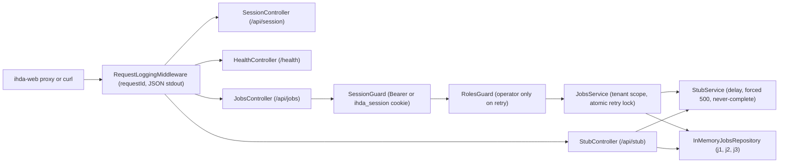

# ihda-api: Integration Health Dashboard API stub

NestJS TypeScript backend service for the Integration Health Dashboard. This repository runs locally as the API stub service alongside `ihda-web` in a two-repository Simple SOA layout.

## Architecture overview



Directory structure:

- `src/main.ts`: Application bootstrap, cookie parser, CORS configuration, and shutdown hooks.
- `src/app.module.ts`: Root module wiring `RequestLoggingMiddleware` across routes.
- `src/common/types.ts`: Domain types, DTO interfaces, and runtime type guards (`isVenueId`, `isSessionId`).
- `src/common/structured-logger.ts`: Structured JSON logger writing to `stdout` and attaching `x-request-id`.
- `src/health/`: Liveness endpoint at `GET /health`.
- `src/session/`: Synthetic session lookup, cookie login endpoint, `SessionGuard`, and `RolesGuard`.
- `src/jobs/`: `JobsRepository` interface, `InMemoryJobsRepository`, `JobsService`, and `JobsController`.
- `src/stub/`: Deterministic delay, error injection, never-complete mode, and fixture reset endpoints.
- `src/swagger/`: OpenAPI 3 DTO schemas (`swagger.dto.ts`) and Swagger UI setup (`swagger.setup.ts`) served at `/docs` and `/docs-json`.
- `test/api.e2e-spec.ts`: Jest and Supertest API suite covering auth, tenant isolation, duplicate retries, fault modes, and Swagger OpenAPI samples.

## Prerequisites and local setup

Requirements to run locally without Docker:

- Node.js 22 and npm 10 (no database, Redis, or external cloud accounts required).
- Available TCP port `4000` (configurable via `PORT` in `.env`).

Use the same verification and run commands across local setup and CI (`.github/workflows/ci.yml`):

```bash
cp .env.example .env
npm ci
npm run typecheck
npm run lint
npm test
npm run build
npm run start
```

For local development with file watching:

```bash
npm run dev
```

The service listens on `http://localhost:4000` by default. Interactive Swagger documentation with sample requests and responses is served at `http://localhost:4000/docs` (OpenAPI JSON at `http://localhost:4000/docs-json`).

## Synthetic sessions and access boundaries

Role and tenant boundaries are enforced on the server in `SessionGuard`, `RolesGuard`, and `JobsService`, not only in the UI.

| Session ID | Tenant | Permitted venues | Role | Allowed operations |
| --- | --- | --- | --- | --- |
| `operator-A` | `A` | `A1`, `A2` | `operator` | List and read `A1` and `A2` jobs, retry failed jobs in tenant `A` |
| `viewer-A` | `A` | `A1`, `A2` | `viewer` | List and read `A1` and `A2` jobs, retry rejected with `403` |
| `operator-B` | `B` | `B1` | `operator` | List and read `B1` jobs, retry failed jobs in tenant `B` |

Requests authenticate in either of two ways:

1. `Authorization: Bearer <sessionId>` header.
2. `POST /api/session` with `{"sessionId": "operator-A"}`, which sets an `HttpOnly`, `SameSite=Lax` cookie named `ihda_session`.

If both are absent or invalid, protected routes return `401 Unauthorized`. If `Authorization` is present with an invalid token, `SessionGuard` rejects the request immediately with `401` without falling back to cookies.

## API reference

| Method and path | Auth required | Success status | Behavior and error responses |
| --- | --- | --- | --- |
| `GET /docs` and `GET /docs-json` | No | `200` | Interactive Swagger UI and OpenAPI 3 JSON schema with sample requests and responses |
| `GET /health` | No | `200` | Returns `{ status: "ok", service: "ihda-api", timestamp }` |
| `GET /api/session` | Yes | `200` | Returns `{ sessionId, tenantId, venueIds, role }`, or `401` |
| `POST /api/session` | No | `200` | Sets `ihda_session` cookie for valid `sessionId`, clears it when `null`, or returns `400` |
| `GET /api/jobs` | Yes | `200` | Optional `?venueId=`. Returns `{ items }` for the active tenant. Returns `403` for unpermitted venues before applying delay or faults |
| `GET /api/jobs/:id` | Yes | `200` | Returns job detail and `pollCount`. Returns `404` if missing, `403` for another tenant |
| `POST /api/jobs/:id/retry` | Operator | `202` | Returns `{ jobId, status: "QUEUED" }`. Returns `403` for viewer or cross-tenant job, `404` if missing, `409` if already `QUEUED` or `HEALTHY` |
| `GET /api/stub/config` | No | `200` | Returns active stub settings |
| `POST /api/stub/config` | No | `200` | Updates validated stub settings, or returns `400` on invalid inputs |
| `POST /api/stub/reset` | No | `200` | Resets jobs `j1..j3` and stub settings to initial defaults |

## Fixtures, reset, and fault modes

Initial fixtures created by `createInitialFixtures()` in `src/jobs/jobs.repository.ts`:

| Job ID | Tenant | Venue | Provider | Initial status | `lastSuccessAt` |
| --- | --- | --- | --- | --- | --- |
| `j1` | `A` | `A1` | `Mock POS` | `FAILED` | `2026-11-23T09:00:00Z` |
| `j2` | `A` | `A2` | `Mock HR` | `HEALTHY` | `2026-11-24T01:00:00Z` |
| `j3` | `B` | `B1` | `Mock Reservations` | `FAILED` | `null` |

Retry completion rules in `JobsService.getJobDetail`:

- When `neverComplete` is `false`, a `QUEUED` job becomes `HEALTHY` on the second `GET /api/jobs/:id` poll, sets `lastSuccessAt` to the current UTC ISO timestamp, clears `lastError`, and resets `pollCount` to `0`.
- When `neverComplete` is `true`, `GET /api/jobs/:id` increments `pollCount` and leaves the job in `QUEUED`.

Configurable fields in `POST /api/stub/config`:

- `delayMs`: integer from `0` to `10000`.
- `delayVenueId`: `"A1"`, `"A2"`, `"B1"`, or `null` to apply delay to all venues.
- `force500`: boolean; when `true`, read endpoints always fail with HTTP `500`.
- `force500Remaining`: integer from `0` to `20`; fails that many read requests with HTTP `500` and then recovers on the next read.
- `neverComplete`: boolean; keeps retried jobs in `QUEUED`.

To restore initial fixtures and clear all fault modes, call `POST /api/stub/reset`.

## Sample requests

```bash
# 1. Inspect health and operator-A session
curl -s http://localhost:4000/health
curl -s http://localhost:4000/api/session -H "Authorization: Bearer operator-A"

# 2. List jobs for venue A1
curl -s "http://localhost:4000/api/jobs?venueId=A1" -H "Authorization: Bearer operator-A"

# 3. Retry j1 (202 QUEUED), then poll twice until HEALTHY
curl -i -X POST http://localhost:4000/api/jobs/j1/retry -H "Authorization: Bearer operator-A"
curl -s http://localhost:4000/api/jobs/j1 -H "Authorization: Bearer operator-A"
curl -s http://localhost:4000/api/jobs/j1 -H "Authorization: Bearer operator-A"

# 4. Verify viewer cannot retry (403) and tenant A cannot access tenant B (403)
curl -i -X POST http://localhost:4000/api/jobs/j1/retry -H "Authorization: Bearer viewer-A"
curl -i http://localhost:4000/api/jobs/j3 -H "Authorization: Bearer operator-A"
curl -i "http://localhost:4000/api/jobs?venueId=B1" -H "Authorization: Bearer operator-A"

# 5. Simulate one 500 failure and verify recovery on the next read
curl -s -X POST http://localhost:4000/api/stub/config \
  -H "Content-Type: application/json" \
  -d "{\"force500Remaining\": 1}"
curl -i "http://localhost:4000/api/jobs?venueId=A1" -H "Authorization: Bearer operator-A"
curl -i "http://localhost:4000/api/jobs?venueId=A1" -H "Authorization: Bearer operator-A"

# 6. Simulate delay on A1 and never-complete mode, then reset fixtures
curl -s -X POST http://localhost:4000/api/stub/config \
  -H "Content-Type: application/json" \
  -d "{\"delayMs\": 1200, \"delayVenueId\": \"A1\", \"neverComplete\": true}"
curl -s -X POST http://localhost:4000/api/stub/reset
```

## Automated tests

Run the API integration suite in `test/api.e2e-spec.ts` with `npm test` (`jest --runInBand`):

1. `GET /health` returns `200`.
2. Unauthenticated requests to `/api/session`, `/api/jobs`, and `/api/jobs/j1/retry` return `401`.
3. Happy path for `operator-A`: filters by `venueId=A1`, retries `j1` (`202 QUEUED`), observes `QUEUED` on poll 1, and observes `HEALTHY` on poll 2.
4. Viewer enforcement: `viewer-A` can read `A1` jobs, while direct `POST /api/jobs/j1/retry` returns `403` without changing `j1`.
5. Tenant isolation: `operator-A` cannot list `venueId=B1`, read `j3`, or retry `j3` (`403`); `operator-B` sees only `j3` and receives `403` on `j1`.
6. Duplicate concurrent retry handling: two parallel `POST /api/jobs/j1/retry` calls return one `202` and one `409`, and subsequent calls return `409`.
7. Deterministic fault modes: `force500Remaining: 1` returns `500` once and recovers to `200`; `neverComplete: true` keeps `j1` in `QUEUED` across four polls; `delayMs` with `delayVenueId: "A1"` delays `A1`.
8. Cookie login via `POST /api/session` sets `ihda_session` and enforces `viewer` restrictions on subsequent requests.
9. Swagger UI (`GET /docs/`) and OpenAPI JSON (`GET /docs-json`) load with Bearer and Cookie security schemes and named sample requests and responses.

Latest verified run: `npm run typecheck`, `npm run lint`, `npm test` (9 of 9 tests passed), and `npm run build` exited with code `0`.

## Implemented and unfinished requirements

| Area | Status | Notes |
| --- | --- | --- |
| Synthetic sessions and server-side RBAC and tenant guards | Implemented and verified | Enforced in `SessionGuard`, `RolesGuard`, and `JobsService` |
| Deterministic fixtures, 2-poll completion, and `409` retry lock | Implemented and verified | Tested via Supertest and Playwright E2E |
| Delay, `forced500`, `neverComplete`, and `reset` stub endpoints | Implemented and verified | Exposed under `/api/stub/*` |
| Swagger UI and OpenAPI sample requests and responses | Implemented and verified | Served at `/docs` and `/docs-json` with `@nestjs/swagger` |
| Health endpoint and GitHub Actions CI workflow | Implemented | CI workflow uses identical npm scripts |
| Docker local packaging | Removed by request | Configured to run directly with local Node.js 22 |

## Design note, assumptions, and trade-offs

- **Repository abstraction:** `JobsService` depends on the `JobsRepository` token backed by `InMemoryJobsRepository`. Swapping in PostgreSQL for production requires one repository implementation without changing controllers or guards.
- **Synchronous retry locking:** `JobsService.retryJob` validates permissions and performs the `FAILED` to `QUEUED` transition synchronously before returning `202`. Concurrent duplicate requests cannot interleave across an `await` and immediately receive `409 Conflict`.
- **Assumption on cross-tenant errors:** Cross-tenant requests return `403 Forbidden` for known IDs outside the caller's tenant to match the brief's permission test expectations, while non-existent job IDs return `404 Not Found`. In high-sensitivity production environments, returning `404` for cross-tenant IDs avoids disclosing ID existence.
- **Trade-off for Simple SOA vs single-app or full microservices:** Splitting `ihda-api` from `ihda-web` establishes clear service boundaries while avoiding Postgres, Redis, and external identity provider overhead within the 4-hour timebox.
- **Known limitation:** Fixture and stub state lives in Node.js process memory. State resets on process restart and does not synchronize across multiple API processes.

## Deployment note

- **Environment variables:** Defined in `.env.example`.

| Variable | Default | Purpose |
| --- | --- | --- |
| `PORT` | `4000` | HTTP port bound by NestJS |
| `CORS_ORIGIN` | `http://localhost:3000` | Allowed browser origin when requests bypass the `ihda-web` proxy |
| `LOG_LEVEL` | `info` | Runtime logging verbosity placeholder |

- **Secret handling:** No provider credentials, tokens, or real user accounts exist in this stub. In production, store OIDC validation keys, session signing secrets, and provider API keys in a managed secret store injected at runtime, never in `.env` files committed to Git.
- **Health checks:** `GET /health` returns HTTP `200` with service metadata so process supervisors or load balancers can verify readiness before routing `ihda-web` traffic.
- **Logging:** `RequestLoggingMiddleware` emits one structured JSON line per request to `stdout` containing `timestamp`, `level`, `service`, `event`, `requestId`, `method`, `path`, `statusCode`, `durationMs`, `tenantId`, and `role`. `/health` probes are omitted to keep logs quiet.
- **Rollback:** Compiled output in `dist/` builds deterministically from `package-lock.json` via `npm ci` and `npm run build`. Roll back by redeploying the previous Git commit or build artifact and confirming `GET /health` returns `200`.

## Time spent and attribution

- **Time spent:** Approximately 25 minutes for AI-assisted implementation and automated verification of `ihda-api` and `ihda-web` (add your own manual review and walkthrough preparation time before final submission).
- **AI and third-party libraries:** Built and verified with Antigravity and OpenBot coding assistance. Uses NestJS (`@nestjs/common`, `@nestjs/core`, `@nestjs/platform-express`, `@nestjs/swagger`), `swagger-ui-express`, Express, `cookie-parser`, `reflect-metadata`, `rxjs`, Jest, Supertest, `ts-jest`, `@nestjs/cli`, TypeScript, and ESLint.
